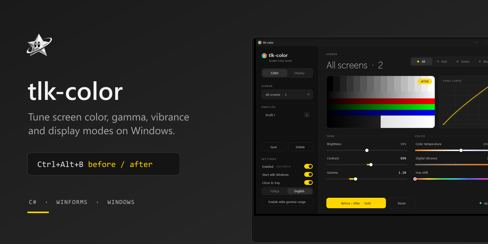
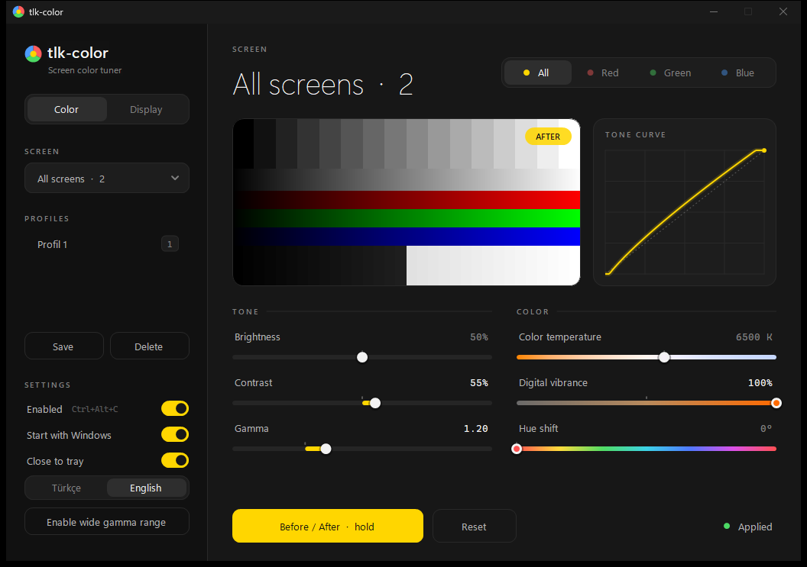
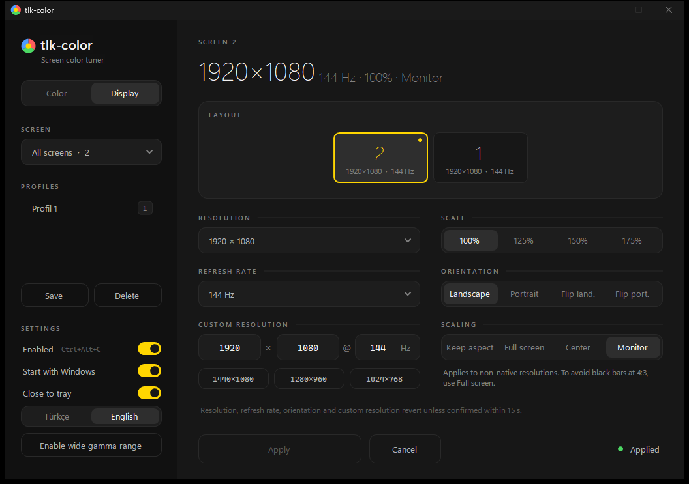

<p align="center"></p>

<p align="center">Free Windows tool to tune screen color and display modes, NVIDIA-Control-Panel-style, in one small exe.</p>

<p align="center">
<a href="https://talkdedsec.github.io/tlk-color/">Website</a> ·
<a href="https://github.com/Talkdedsec/tlk-color/releases/latest">Download</a> ·
<a href="https://talkdedsec.com">talkdedsec.com</a> ·
<a href="README.tr.md">Türkçe</a>
</p>




## Features

- Color per display or for all displays: brightness, contrast, gamma per channel (All/R/G/B), color temperature 1900-10000 K.
- Digital vibrance and hue on NVIDIA-connected displays.
- Before/After: hold the button or Space; Ctrl+Alt+B locks it.
- Profiles with global hotkeys.
- Display page: monitor layout map, resolution, refresh rate, scale %, orientation.
- Custom resolution (W x H @ Hz), 4:3 presets (1440x1080, 1280x960, 1024x768), scaling modes: keep aspect / full screen / center / monitor.
- Mode changes roll back unless confirmed within 15 s.
- Tray icon, start with Windows, re-applies after display, session and sleep changes.
- English and Turkish UI (switch in the sidebar settings). C# WinForms, .NET 9, no dependencies.

## Install

Requires Windows 10/11 x64 and the .NET 9 Desktop Runtime.

Download `tlk-color.exe` from the [latest release](https://github.com/Talkdedsec/tlk-color/releases/latest) and run it. No installer.

## Usage

| Hotkey | Action |
|---|---|
| Ctrl+Alt+1 ... 9 | Apply profile |
| Ctrl+Alt+0 | Reset |
| Ctrl+Alt+C | Toggle on/off |
| Ctrl+Alt+B | Lock Before/After |

Settings are stored in `%AppData%\tlk-color\config.json`.

The "Wide gamma range" button writes HKLM `GdiIcmGammaRange=256` (asks for admin) so Windows accepts stronger ramps.

## Build from source

```
dotnet run
dotnet publish -c Release -r win-x64 --self-contained false -p:PublishSingleFile=true
tlk-color.exe --selftest
```

The last command runs the hardware self-test.

## Limits

- Gamma applies to the whole monitor.
- Some fullscreen games reset it.
- Vibrance/hue and driver-level custom resolutions need NVIDIA.

## License

[MIT](LICENSE) · [Security](SECURITY.md)

---

Talkdedsec · https://talkdedsec.com
