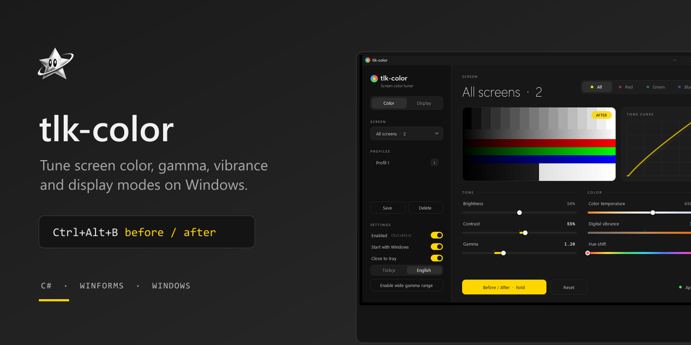
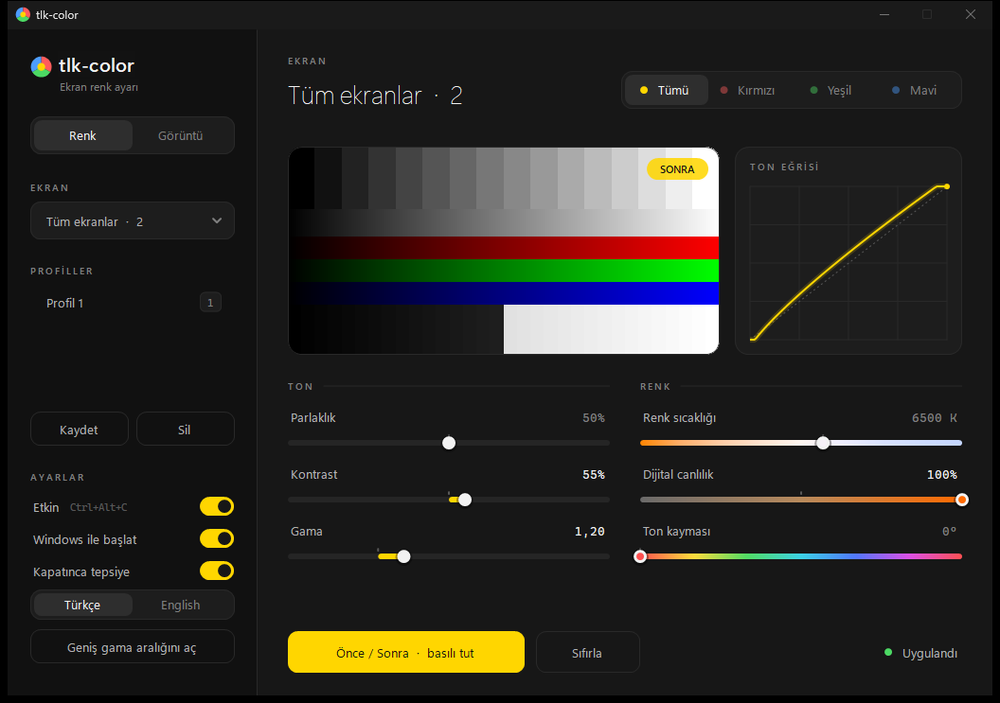
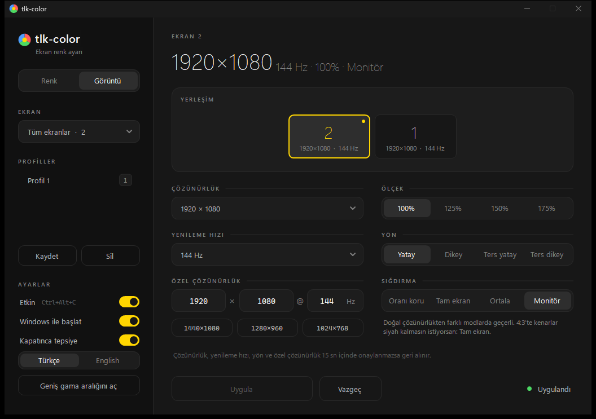

<p align="center"></p>

<p align="center">Ekran rengini ve görüntü modlarını ayarlayan, NVIDIA Denetim Masası tarzı, tek küçük exe'lik ücretsiz Windows aracı.</p>

<p align="center">
<a href="https://talkdedsec.github.io/tlk-color/">Web sitesi</a> ·
<a href="https://github.com/Talkdedsec/tlk-color/releases/latest">İndir</a> ·
<a href="https://talkdedsec.com">talkdedsec.com</a> ·
<a href="README.md">English</a>
</p>




## Özellikler

- Ekran başına ya da tüm ekranlar için renk: parlaklık, kontrast, kanal başına gama (Tümü/R/G/B), renk sıcaklığı 1900-10000 K.
- NVIDIA bağlı ekranlarda dijital canlılık ve ton.
- Önce/Sonra: düğmeye ya da Boşluk tuşuna basılı tut; Ctrl+Alt+B kilitler.
- Genel kısayollarla profiller.
- Ekran sayfası: monitör yerleşim haritası, çözünürlük, yenileme hızı, ölçek %, yönlendirme.
- Özel çözünürlük (G x Y @ Hz), 4:3 hazır ayarlar (1440x1080, 1280x960, 1024x768), ölçekleme modları: en-boy koru / tam ekran / ortala / monitör.
- Mod değişiklikleri 15 sn içinde onaylanmazsa geri alınır.
- Tepsi simgesi, Windows ile başlat; ekran, oturum ve uyku değişikliklerinden sonra yeniden uygular.
- İngilizce ve Türkçe arayüz (kenar çubuğu ayarlarından değişir). C# WinForms, .NET 9, bağımlılık yok.

## Kurulum

Windows 10/11 x64 ve .NET 9 Desktop Runtime gerekir.

[Son sürümden](https://github.com/Talkdedsec/tlk-color/releases/latest) `tlk-color.exe` dosyasını indirip çalıştır. Kurulum gerekmez.

## Kullanım

| Kısayol | İşlev |
|---|---|
| Ctrl+Alt+1 ... 9 | Profil uygula |
| Ctrl+Alt+0 | Sıfırla |
| Ctrl+Alt+C | Aç/kapat |
| Ctrl+Alt+B | Önce/Sonra'yı kilitle |

Ayarlar `%AppData%\tlk-color\config.json` içinde tutulur.

"Geniş gama aralığı" düğmesi HKLM `GdiIcmGammaRange=256` değerini yazar (yönetici izni ister); böylece Windows daha güçlü eğrileri kabul eder.

## Kaynaktan derleme

```
dotnet run
dotnet publish -c Release -r win-x64 --self-contained false -p:PublishSingleFile=true
tlk-color.exe --selftest
```

Son komut donanım öz sınamasını çalıştırır.

## Sınırlar

- Gama tüm monitöre uygulanır.
- Bazı tam ekran oyunlar gamayı sıfırlar.
- Canlılık/ton ve sürücü düzeyinde özel çözünürlükler NVIDIA gerektirir.

## Lisans

[MIT](LICENSE) · [Güvenlik](SECURITY.md)

---

Talkdedsec · https://talkdedsec.com
